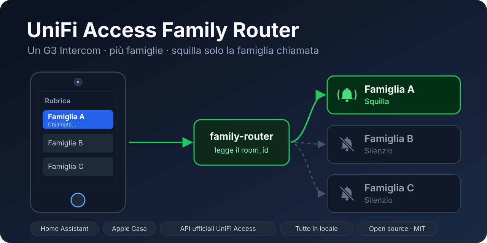

# UniFi Access Family Router

🇬🇧 [Read in English](README.md)



**Un G3 Intercom UniFi, più famiglie, ognuna con il suo Home Assistant e la
sua Apple Casa: squilla solo la famiglia che il visitatore ha chiamato.**

UniFi Access fa scegliere al visitatore una famiglia nella rubrica del
citofono, ma le integrazioni per la casa smart sanno solo che "qualcuno ha
suonato". Questo progetto ascolta le **API ufficiali di UniFi Access**, legge
quale voce della rubrica è stata chiamata (`room_id`) e fa squillare **solo
quella famiglia**:

- 🍎 **Apple Casa**: campanello con anteprima e video dal vivo, più una
  serratura per ogni porta, tramite il HomeKit Bridge di Home Assistant
  ([pacchetto pronto](examples/packages/intercom_family.yaml)); per parlare
  c'è [homebridge-unifi-protect](https://github.com/hjdhjd/homebridge-unifi-protect)
- 🏠 **Home Assistant**, tramite MQTT discovery (evento campanello, stato
  della chiamata, un pulsante Apri e una serratura per ogni porta:
  *Portone*, *Cancello*, *Garage*…)

Ogni famiglia ha **la sua copia**: suo token API, suo broker MQTT, suo
Homebridge, suo Home Assistant. In comune ci sono solo il citofono e la
console UniFi nell'armadio delle scale.

> **Stato:** 0.2.0. Verificato con test automatici basati sulla
> documentazione ufficiale delle API di UniFi Access (v4.2.16) e con la
> simulazione di un palazzo con 3 famiglie. Non ancora confermato su un G3
> Intercom vero: leggi i [limiti da conoscere](#limiti-da-conoscere) e fai
> la [lista di prova](docs/it/testing-checklist.md) sul tuo impianto.

[](https://my.home-assistant.io/redirect/supervisor_add_addon_repository/?repository_url=https%3A%2F%2Fgithub.com%2Falfo152%2Funifi-access-family-router)

## 🧪 Cerco tester

Hai un **G3 Intercom** (o Intercom) con **UniFi Access** e almeno due voci
in rubrica? Installa il router, lascia `learn_mode: true`, chiama ogni voce
una volta e
[manda un resoconto](https://github.com/alfo152/unifi-access-family-router/issues/new?template=test_report.yml)
(anche in italiano).

La risposta più utile in assoluto: **ogni voce della rubrica mostra un
`room_id` diverso nel log?** Con le impostazioni di partenza (nessun ID di
famiglia, apertura spenta) il router scrive solo nel log: non squilla nulla
e non apre nessuna porta. Togli token e password da quello che incolli.

### Verifica in 5 minuti senza Home Assistant

Niente Home Assistant, Homebridge o MQTT? Lo script
[`tools/watch_calls.py`](tools/watch_calls.py) risponde alla stessa domanda
con solo Python 3.8+ su un computer che raggiunge la console. Ascolta e
basta.

1. In UniFi Access: *Settings → General → Advanced → API Token*
   (Impostazioni → Generali → Avanzate), crea un token con il solo permesso
   **view:device** (non può aprire porte; cancellalo dopo la prova).
2. Scarica e avvia lo script:

   ```sh
   curl -O https://raw.githubusercontent.com/alfo152/unifi-access-family-router/main/tools/watch_calls.py
   python3 watch_calls.py IP_DELLA_CONSOLE --lang it
   ```

   Su Windows al posto di `python3` scrivi `py`. Se il computer è in
   italiano i messaggi sono già in italiano anche senza `--lang it`.

3. Incolla il token quando lo chiede, dal citofono chiama una volta ogni
   voce della rubrica, premi **Ctrl+C** e condividi il riepilogo (non
   contiene il token).

---

## Come funziona

```text
                 Scale (in comune)                       Famiglia A (privato)
  ┌───────────────────────────────────────┐   ┌──────────────────────────────────────┐
  │ G3 Intercom ── rubrica: A / B / C     │   │ family-router (token A)              │
  │      │                                │   │   room_id == A ? ──► broker MQTT A   │
  │ Console UniFi (Access + Protect) ─────┼──►│                          │           │
  │   WebSocket access.remote_view        │   │   Home Assistant A ◄─────┘           │
  │   { room_id: "WR-…A…", request_id }   │   │   (evento campanello, porte)         │
  │                                       │   │    └─► HomeKit Bridge ─► Apple Casa A│
  │                                       │   │        (squillo, video, serrature)   │
  │                                       │   │   Homebridge A ─► Apple Casa A (voce)│
  └───────────────────────────────────────┘   └──────────────────────────────────────┘
                                   (uguale per la famiglia B e la famiglia C)
```

1. Il visitatore sceglie una famiglia nella rubrica del G3 Intercom.
2. La console manda `access.remote_view` sul WebSocket delle notifiche.
   Contiene il `room_id` della voce chiamata (la versione webhook no).
3. Il router di ogni famiglia confronta il `room_id` con la propria
   configurazione. Reagisce solo quello giusto:
   - fa scattare l'evento **Doorbell** (campanello) e accende **Call
     active** (chiamata in corso) nel Home Assistant di quella famiglia; il
     HomeKit Bridge di Home Assistant fa squillare l'Apple Casa di quella
     famiglia (notifica con anteprima, video dal vivo);
   - se vuoi, pubblica `true` su `unifi/protect/<MAC del G3>/doorbell/set`
     per homebridge-unifi-protect (utile quando arriverà
     [HBUP#1363](https://github.com/hjdhjd/homebridge-unifi-protect/issues/1363),
     vedi [limiti da conoscere](#limiti-da-conoscere)).
4. Quando la chiamata finisce (risposta, apertura, annullata, scaduta) Home
   Assistant riceve l'evento **Call result** (esito) e **Call active** si
   spegne.
5. **Apertura**: ogni porta ha un pulsante in Home Assistant e una serratura
   (la serratura è quella che vede Apple Casa, con Face ID). Entrambi usano
   l'endpoint ufficiale di apertura; il registro di Access mostra quale
   famiglia ha aperto.

## Funzioni

- Smistamento con il `room_id` (voce della rubrica), con regole facoltative
  su `door_guard_ids` e sugli ID dei citofoni `device_ids`; `ring_all` per i
  palazzi con una sola famiglia.
- **Modalità apprendimento** per scoprire il `room_id` di ogni voce della
  rubrica.
- MQTT discovery per Home Assistant: `event` Doorbell (`device_class:
  doorbell`, usabile come `linked_doorbell_sensor` di HomeKit), `event` Call
  result, `binary_sensor` Call active, sensore diagnostico per
  l'apprendimento.
- **Più porte per famiglia** (fino a 10): un `button` e una `lock` per
  ognuna. La serratura mostra *aperta* dopo l'apertura, di nuovo *chiusa*
  dopo qualche secondo, *bloccata* se la console ha rifiutato. Le entità
  delle porte tolte vengono cancellate da sole.
- Apertura con il nome della famiglia nel registro di Access, attesa tra due
  pressioni per ogni porta, comandi "retained" ignorati e cancellati
  (altrimenti aprirebbero la porta a ogni ricollegamento).
- **Certificato della console fissato** (impronta SHA-256).
- Ricollegamento automatico del WebSocket di Access (con heartbeat) e di
  MQTT, indipendenti tra loro. Le chiamate rimaste in coda durante un guasto
  MQTT vengono scartate se più vecchie di 15 s: nessuno squilla minuti dopo
  che il visitatore se n'è andato.
- **Add-on** di Home Assistant, immagine **Docker** autonoma, **pacchetto
  docker compose** per famiglia (Mosquitto + router + Homebridge).
- **Nessuna dipendenza esterna** per funzionare (solo la libreria standard
  di Python 3.11+).

## Cosa serve

| Componente | Note |
| --- | --- |
| Console UniFi con **UniFi Access** e **UniFi Protect** | Per esempio UCG-Max (con un disco per Protect) |
| **G3 Intercom** + hub della porta (per esempio Door Hub Mini) | Rubrica con una voce per famiglia |
| Per ogni famiglia: un piccolo computer sempre acceso | Con HA OS (add-on) o Docker (pacchetto) |
| Per ogni famiglia: broker MQTT | Add-on Mosquitto o il Mosquitto del pacchetto |
| Per ogni famiglia: HomeKit Bridge di Home Assistant | Squillo e serrature in Apple Casa ([guida](docs/it/homekit-bridge.md)) |
| Per ogni famiglia: Homebridge + homebridge-unifi-protect ≥ 8.0 | Per parlare da Apple Casa (richiede Homebridge 2.0) |
| Rete | Ogni famiglia raggiunge la console sulla porta TCP 12445 (API di Access) e sulle porte di Protect |

## Avvio rapido

1. **Configurazione UniFi** (rubrica, un token API e un utente locale per
   famiglia, reti separate): [docs/it/unifi-setup.md](docs/it/unifi-setup.md)
2. **Installa il router per ogni famiglia**
   - Home Assistant OS: installa l'add-on **Mosquitto broker** e
     l'integrazione **MQTT**, poi aggiungi questo repository con il pulsante
     **Aggiungi il repository** qui sopra (oppure *Impostazioni → Componenti
     aggiuntivi → Negozio → ⋮ → Repository*) e installa **UniFi Access
     Family Router**. Compila `access.host`, `access.token`,
     `access.tls_fingerprint`, `family.name`; lascia `mqtt.host` vuoto (usa
     il broker di Home Assistant);
   - oppure Docker: copia la cartella [`stack/`](stack/) sul computer della
     famiglia e segui i comandi in cima a
     [`stack/docker-compose.yml`](stack/docker-compose.yml).
3. **Leggi l'impronta del certificato** della console e mettila in
   `access.tls_fingerprint`:

   ```bash
   python -m family_router --fingerprint 192.168.50.1
   # pacchetto Docker: docker compose run --rm router --fingerprint 192.168.50.1
   ```

4. **Modalità apprendimento**: avvia con `learn_mode: true`, dal citofono
   chiama una volta ogni voce della rubrica, copia il `room_id` della *tua*
   famiglia dal log (o dal sensore *Last ring room_id*) in
   `family.match.room_ids` (nell'add-on: `family.room_ids`), poi metti
   `learn_mode: false` e riavvia. Nel log trovi una riga per ogni chiamata:
   `LEARN: ring … room_id=WR-… -> no match`. Se tutte le voci danno lo
   stesso `room_id`, usa `door_guard_ids` (i destinatari della chiamata) e
   segnalalo su GitHub.
5. **Porte** (facoltativo): la modalità apprendimento scrive anche una riga
   pronta per ogni porta, per esempio
   `LEARN: door 'Portone' -> door_id … (add-on: unlock.doors "Portone=…")`.
   Metti `unlock.enabled: true` e in `unlock.doors` una riga per porta:

   ```yaml
   doors:
     - Portone=0ed545f8-…
     - Cancello=a8f2c6d1-…
   ```

   Fino a 10 porte; per ognuna Home Assistant crea un pulsante e una
   serratura ([dettagli](docs/it/home-assistant.md#3-porte)).
6. **Apple Casa**: [docs/it/homekit-bridge.md](docs/it/homekit-bridge.md)
   (squillo e serrature, pacchetto pronto da copiare: si inquadrano 2 codici
   QR con l'app Casa) e [docs/it/homekit.md](docs/it/homekit.md) (parlare,
   con il riquadro di homebridge-unifi-protect tenuto silenzioso).
7. **Home Assistant** (schermata, notifica con Apri):
   [docs/it/home-assistant.md](docs/it/home-assistant.md)
8. **Fai la lista di prova**: [docs/it/testing-checklist.md](docs/it/testing-checklist.md):
   ogni famiglia riceve solo le sue chiamate, l'apertura funziona e il
   registro di Access mostra quale famiglia ha aperto.

**Riga di comando.** Da una copia del repository esegui una volta
`pip install .`: da lì `family-router …` equivale a
`python -m family_router …` (oppure, senza installare,
`PYTHONPATH=family_router/app python -m family_router …`). Nel pacchetto
Docker usa `docker compose run --rm router …`.

Controlla in ogni momento la configurazione e il token:

```bash
python -m family_router --config config.yaml --check
python -m family_router --config config.yaml --list-doors
# pacchetto Docker:
docker compose run --rm router --config /config/config.yaml --check
```

## Configurazione

Esempio completo: [`config.example.yaml`](config.example.yaml). L'add-on usa
le stesse opzioni (le regole di riconoscimento stanno direttamente sotto
`family`).

| Opzione | Predefinito | Descrizione |
| --- | --- | --- |
| `access.host` | – | IP o nome della console UniFi (senza `https://`) |
| `access.port` | `12445` | Porta delle API di Access |
| `access.token` | – | Token API di questa famiglia. Variabile d'ambiente alternativa: `FAMILY_ROUTER_ACCESS_TOKEN` |
| `access.tls_fingerprint` | `""` | SHA-256 del certificato della console (ammessi i due punti). **Consigliato** |
| `access.verify_ssl` / `access.ca_file` | `false` / `""` | Verifica con una CA al posto dell'impronta |
| `family.name` / `family.id` | – | Nome mostrato / id nei topic (`a-z`, `0-9`, `_`; ricavato dal nome se vuoto) |
| `family.match.room_ids` | `[]` | `room_id` delle voci di questa famiglia |
| `family.match.door_guard_ids` | `[]` | Squilla se uno di questi ID è tra i `door_guard_ids` |
| `family.match.device_ids` | `[]` | Reagisce solo a questi citofoni |
| `family.match.ring_all` | `false` | Squilla a ogni chiamata (palazzo con una sola famiglia) |
| `mqtt.host` / `mqtt.port` | – / `1883` | Il broker della famiglia. Add-on: vuoto = broker di Home Assistant |
| `mqtt.username` / `mqtt.password` | `""` | Credenziali del broker |
| `mqtt.tls` / `mqtt.tls_insecure` | `false` | MQTT su TLS / salta la verifica TLS |
| `mqtt.base_topic` | `access_family_router` | Prefisso dei topic |
| `mqtt.discovery` / `mqtt.discovery_prefix` | `true` / `homeassistant` | Discovery di Home Assistant |
| `homebridge.enabled` | `false` | Fa suonare il campanello di homebridge-unifi-protect |
| `homebridge.topic_prefix` | `unifi/protect` | = `mqttTopic` del plugin |
| `homebridge.camera_mac` | – | MAC del G3 Intercom in Protect (qualsiasi formato) |
| `unlock.enabled` | `false` | Crea un pulsante Apri e una serratura per porta |
| `unlock.doors` | `[]` | Porte da aprire: elementi `{name, door_id}` oppure righe `"Nome=door_id"` (add-on). ID dalla modalità apprendimento o da `--list-doors`; fino a 10 |
| `unlock.door_id` | – | Vecchia opzione a porta singola (usa questa oppure `unlock.doors`) |
| `unlock.actor_name` | `<nome> (family router)` | Nome mostrato nel registro di Access |
| `unlock.cooldown_seconds` | `3` | Ignora le pressioni ripetute (per porta) |
| `unlock.relock_seconds` | `5` | Secondi in cui la serratura risulta *aperta* prima di tornare *chiusa* (1–60) |
| `learn_mode` | `false` | Scrive/pubblica gli ID di ogni chiamata |
| `call_timeout_seconds` | `60` | Chiude una chiamata che non ha mai ricevuto l'evento di fine |
| `log_level` | `info` | `debug`, `info`, `warning`, `error` |

## Topic MQTT

`<base>` = `access_family_router/<family.id>`

| Topic | Direzione | Contenuto |
| --- | --- | --- |
| `<base>/status` | uscita, retained | `online` / `offline` (Last Will) |
| `<base>/ring` | uscita | `{"event_type":"ring","request_id","room_id","door_name","device_name"}` |
| `<base>/call` | uscita, retained | `ON` / `OFF` |
| `<base>/call_result` | uscita | `{"event_type":"answered_elsewhere\|unlocked\|rejected\|canceled\|timeout\|expired\|unknown","reason_code","request_id"}` |
| `<base>/learn` | uscita, retained | ID dell'ultima chiamata (solo modalità apprendimento) |
| `<base>/unlock/<porta>/set` | entrata | `PRESS` o `UNLOCK` apre; `LOCK` aggiorna solo lo stato; i messaggi retained sono ignorati e cancellati |
| `<base>/unlock/<porta>/state` | uscita, retained | `LOCKED` / `UNLOCKED` / `JAMMED` |
| `<base>/unlock/<porta>/result` | uscita | `{"ok":true,"door":"portone","time":…}` oppure `{"ok":false,"door":…,"error":…}` |
| `<homebridge.topic_prefix>/<MAC>/doorbell/set` | uscita | `true` |

`<porta>` è il nome della porta in minuscolo e senza accenti (`Cancello
carrabile` → `cancello_carrabile`). Con la vecchia opzione `unlock.door_id`
i topic sono `<base>/unlock/set`, `<base>/unlock/state` e
`<base>/unlock/result`.

## Sicurezza

- **Un token API per famiglia**, solo con i permessi necessari:
  `view:device` (notifiche) e, solo se vuoi aprire le porte, `view:space` +
  `edit:space`. Mai un account admin.
- Ogni token vede le notifiche del citofono (quale voce è stata chiamata e
  quando), ma ogni router agisce solo sulle chiamate della sua famiglia.
- **Fissa il certificato della console** (`access.tls_fingerprint`).
- Il comando di apertura passa dal broker della famiglia: **disattiva
  l'accesso anonimo** e usa una password per ogni client (il pacchetto
  Docker lo fa già).
- Separa la rete di ogni famiglia dalle altre; permetti solo le porte della
  console che servono ([docs/it/unifi-setup.md](docs/it/unifi-setup.md)).

## Limiti da conoscere

- **Hardware vero**: il significato di `room_id` è dedotto dalla
  documentazione ufficiale delle API (l'endpoint *Trigger Doorbell*
  identifica una voce della rubrica con `room_name`). La modalità
  apprendimento mostra i valori veri: controlla sul tuo G3 Intercom che ogni
  voce abbia il suo `room_id`. Se non è così, la regola di riserva è
  `door_guard_ids` (i destinatari della chiamata).
- **Apple Casa, squilli automatici**: homebridge-unifi-protect ≥ 8.0 fa
  squillare HomeKit a *ogni* pressione del citofono, e il suo interruttore
  `Doorbell.Mute` zittisce anche gli squilli comandati via MQTT (verificato
  nel codice della versione 8.4.0). Per questo oggi lo squillo per famiglia
  in Apple Casa passa dal HomeKit Bridge di Home Assistant
  ([docs/it/homekit-bridge.md](docs/it/homekit-bridge.md)), con il riquadro
  HBUP tenuto silenzioso per parlare. All'autore è stata chiesta un'opzione
  per ignorare gli squilli automatici di Access
  ([homebridge-unifi-protect#1363](https://github.com/hjdhjd/homebridge-unifi-protect/issues/1363)).
- **Telecamera del G3 Intercom in Home Assistant**: la strada del HomeKit
  Bridge richiede che il G3 Intercom compaia come telecamera
  nell'integrazione ufficiale UniFi Protect; da confermare su un G3 vero.
- **Audio nei due sensi in Apple Casa**: lo fornisce homebridge-unifi-protect
  e dipende da Protect, che deve offrire il parla/ascolta per il G3 Intercom
  (un proprietario di G3 ha confermato che la sessione nativa di Protect
  funziona). Il plugin non ha la cancellazione dell'eco: nell'app Casa senti
  la tua voce (chi è alla porta sente bene).
- **Parlare da una schermata di Home Assistant** non fa parte di questo
  progetto.
- Il router di ogni famiglia deve raggiungere direttamente la console
  (TCP 12445).

## Sviluppo

```bash
python -m unittest discover -s tests -t .     # 3.11+, nessuna dipendenza
python -m pytest                              # gli stessi test con pytest
python -m mypy --strict family_router/app/family_router
```

I test comprendono: controllo della configurazione, lettura dei messaggi
ufficiali, smistamento per tre famiglie, codifica MQTT verificata con la
specifica MQTT 3.1.1, il client MQTT contro un broker di prova, il client
WebSocket contro la libreria Node.js `ws` su TLS (frammentazione, messaggi
grandi, ping/pong, codici di chiusura, heartbeat, token sbagliato,
certificato fissato), il client REST, il servizio con i ricollegamenti, la
riga di comando, la coerenza di documentazione ed esempi nelle due lingue e
una simulazione completa di un palazzo con 3 famiglie. I test WebSocket e di
simulazione completa vengono saltati se mancano `node` e il modulo `ws`
(`WS_MODULE_PATH`).

## Avvertenze

Non affiliato né approvato da Ubiquiti Inc. UniFi, UniFi Access e UniFi
Protect sono marchi di Ubiquiti Inc. HomeKit e Apple Casa sono marchi di
Apple Inc. Uso a tuo rischio: questo programma può aprire una porta.

## Licenza

[MIT](LICENSE) (testo legale in inglese).
